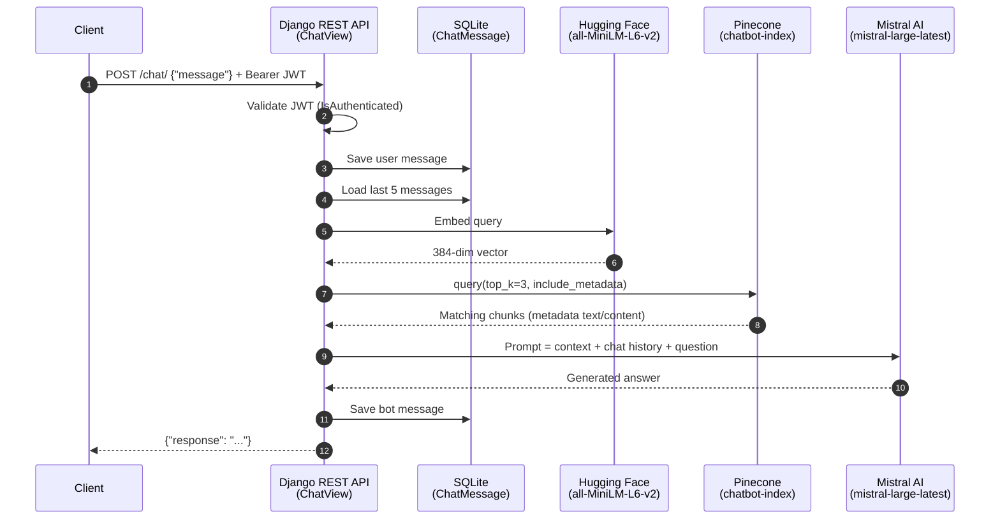

<div align="center">

# Backend-Only AI Chatbot

**A JWT-secured Django REST API that answers questions with Retrieval-Augmented Generation (Pinecone + Hugging Face embeddings + Mistral AI).**

[](https://www.python.org/)
[](https://www.djangoproject.com/)
[](https://www.django-rest-framework.org/)
[](https://github.com/jazzband/djangorestframework-simplejwt)
<br/>
[](https://www.pinecone.io/)
[](https://huggingface.co/sentence-transformers/all-MiniLM-L6-v2)
[](https://mistral.ai/)
[](https://www.langchain.com/)
[](https://www.sqlite.org/)

</div>

---

## Overview

This project is a headless chatbot backend. Users sign up, log in with their email to get JWT tokens, and send messages to a protected `/chat/` endpoint. Each message is embedded, matched against a Pinecone vector index, and combined with the user's recent conversation history into a prompt for Mistral Large. Every user and bot message is persisted, and a background scheduler handles welcome emails and old-chat cleanup.

## Key Features

- **RAG pipeline**: query embedding with `sentence-transformers/all-MiniLM-L6-v2`, top-3 retrieval from Pinecone, answer generation with `mistral-large-latest`.
- **Conversation memory**: the last 5 messages of the user's history are injected into every prompt.
- **JWT authentication**: email-based login via `djangorestframework-simplejwt`; chat endpoints require a Bearer token.
- **Custom user model**: extends `AbstractUser` with `email` as the unique login field.
- **Persistent chat history**: every user and bot message is stored per user and retrievable in chronological order.
- **Background jobs (APScheduler)**: welcome email sent asynchronously after signup, plus a daily job that deletes messages older than 30 days.
- **Auto-provisioned vector index**: creates the `chatbot-index` Pinecone serverless index (384 dims, cosine, AWS `us-east-1`) if it does not exist.
- **Postman collection included**: ready-made requests that save the access token automatically after login.

## How a Chat Request Flows



## Tech Stack

| Layer | Technology |
| --- | --- |
| Web framework | Django, Django REST Framework |
| Authentication | JWT via `djangorestframework-simplejwt` |
| Embeddings | Hugging Face Inference (`langchain-huggingface`, `sentence-transformers/all-MiniLM-L6-v2`) |
| Vector database | Pinecone (serverless) |
| LLM | Mistral AI `mistral-large-latest` via the `mistralai` SDK |
| Relational database | SQLite |
| Background jobs | APScheduler `BackgroundScheduler` |
| Email | Django SMTP backend (Gmail, TLS, port 587) |
| Config | `python-dotenv` |

## Project Structure

```text
Backend-Only-AI-Chatbot/
├── api/
│   ├── migrations/          # Database migrations
│   ├── apps.py              # Starts the APScheduler on app load
│   ├── models.py            # User, ChatMessage, Document
│   ├── rag_service.py       # Embeddings, Pinecone retrieval, Mistral generation
│   ├── serializers.py       # User and ChatMessage serializers
│   ├── tasks.py             # cleanup_old_chats, send_welcome_email, scheduler
│   ├── urls.py              # API routes
│   └── views.py             # Register, Login, Chat, ChatHistory views
├── chatbot/
│   ├── settings.py          # Django, DRF, JWT and SMTP settings
│   ├── urls.py              # Root URLconf (admin + api)
│   ├── asgi.py
│   └── wsgi.py
├── manage.py
├── postman_collection.json  # Postman collection for all endpoints
└── requirements.txt
```

## Getting Started

### Prerequisites

- Python 3
- API keys for Pinecone, Hugging Face and Mistral AI
- A Gmail account with an App Password (for welcome emails)

### Installation

```bash
git clone https://github.com/Tanvir-Chowdhury/Backend-Only-AI-Chatbot.git
cd Backend-Only-AI-Chatbot

python -m venv venv
source venv/bin/activate        # Windows: venv\Scripts\activate

pip install -r requirements.txt
```

Create a `.env` file in the project root (see [Environment Variables](#environment-variables)), then:

```bash
python manage.py migrate
python manage.py runserver
```

The API is served at `http://127.0.0.1:8000/`. The background scheduler starts automatically with the server.

> **Knowledge base note:** retrieval reads the `text` or `content` field from Pinecone match metadata. The repo does not include an ingestion script, so populate `chatbot-index` with your own 384-dimension embeddings before expecting grounded answers.

## Environment Variables

| Variable | Used for |
| --- | --- |
| `PINECONE_API_KEY` | Pinecone vector database access |
| `HUGGINGFACE_API_KEY` | Hugging Face embedding endpoint |
| `MISTRAL_API_KEY` | Mistral AI chat completions |
| `EMAIL_HOST_USER` | Gmail address used to send welcome emails |
| `EMAIL_HOST_PASSWORD` | Gmail App Password |

Where to get them: [Pinecone](https://app.pinecone.io/) · [Hugging Face](https://huggingface.co/settings/tokens) · [Mistral AI](https://admin.mistral.ai/organization/api-keys) · [Gmail App Passwords](https://myaccount.google.com/apppasswords) (requires 2FA)

## API Endpoints

| Method | Path | Auth | Description |
| --- | --- | --- | --- |
| `POST` | `/signup/` | None | Register a user (`email`, `username`, `password`) and queue a welcome email |
| `POST` | `/login/` | None | Exchange `email` + `password` for JWT `access` and `refresh` tokens |
| `POST` | `/chat/` | Bearer JWT | Send a message and receive a RAG-generated answer |
| `GET` | `/chat-history/` | Bearer JWT | List the authenticated user's messages, oldest first |
| `GET` | `/admin/` | Django session | Default Django admin site |

### Example Requests

**Sign up**

```bash
curl -X POST http://127.0.0.1:8000/signup/ \
  -H "Content-Type: application/json" \
  -d '{"email": "user@example.com", "username": "user", "password": "securepassword"}'
```

```json
{ "id": 1, "email": "user@example.com", "username": "user" }
```

**Log in**

```bash
curl -X POST http://127.0.0.1:8000/login/ \
  -H "Content-Type: application/json" \
  -d '{"email": "user@example.com", "password": "securepassword"}'
```

```json
{ "refresh": "<refresh_token>", "access": "<access_token>" }
```

**Chat**

```bash
curl -X POST http://127.0.0.1:8000/chat/ \
  -H "Authorization: Bearer <access_token>" \
  -H "Content-Type: application/json" \
  -d '{"message": "What is the capital of France?"}'
```

```json
{ "response": "..." }
```

A missing `message` returns `400` with `{"error": "Message is required"}`; upstream RAG failures return `500` with an `error` field.

**Chat history**

```bash
curl http://127.0.0.1:8000/chat-history/ \
  -H "Authorization: Bearer <access_token>"
```

```json
[
  { "id": 1, "role": "user", "content": "What is the capital of France?", "timestamp": "..." },
  { "id": 2, "role": "bot",  "content": "...", "timestamp": "..." }
]
```

### Postman

Import `postman_collection.json` into Postman to get the **Backend Only RAG Based Chatbot** collection. Run **Signup**, then **Login** (the access token is saved automatically), then **Send Message** and **Get History**.

## Data Model

| Model | Fields | Notes |
| --- | --- | --- |
| `User` | `email` (unique), `username`, `password` | `USERNAME_FIELD = 'email'` |
| `ChatMessage` | `user`, `role` (`user` / `bot`), `content`, `timestamp` | Cascade-deleted with the user |
| `Document` | `title`, `content`, `created_at` | Metadata reference; vectors live in Pinecone |

## Background Tasks

| Task | Trigger | What it does |
| --- | --- | --- |
| `send_welcome_email` | One-off job right after signup | Sends a welcome email over Gmail SMTP |
| `cleanup_old_chats` | Every 24 hours | Deletes chat messages older than 30 days |

Both run in an APScheduler `BackgroundScheduler` started from `ApiConfig.ready()` in `api/apps.py`.

## Roadmap Ideas

- Document upload endpoint that chunks, embeds and upserts to Pinecone
- Streaming responses over WebSockets (Django Channels)
- PostgreSQL and Celery + Redis for production workloads

## Author

**Md Tanvir Chowdhury**

[](https://github.com/Tanvir-Chowdhury)
[](https://tanvir-chowdhury.github.io/tanvir-portfolio/)
